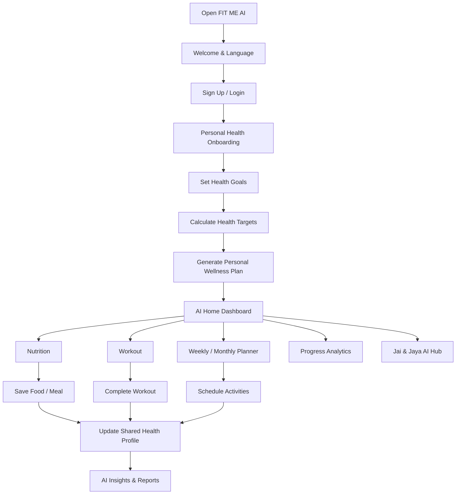

# FIT ME AI: Original Product Specification (v1.0)

Your personal AI health and wellness ecosystem.

> **How to use this document.** This is the original feature specification (v1.0, November 2026).
> It describes every module in detail. `docs/PRD.md` (Master PRD v2.0) is the source of truth for
> business and technical decisions. Where the two disagree, PRD.md wins. In particular:
>
> - **Platform:** React + TypeScript + Vite with Capacitor for iOS and Android (not Flutter). See PRD section 5.
> - **Plans and pricing:** Free / Premium / Pro with country pricing (not Base ₹99 / Premium ₹149 / Luxury ₹249). See PRD sections 2 and 3.
> - **Payments:** Apple and Google in-app purchase on mobile, Cashfree on the web, unified by RevenueCat (not Razorpay). See PRD section 3.
> - **Market:** global from launch, with full localization (not India-only). See PRD section 4.
> - **Roadmap:** PRD section 6 phases replace the roadmap in section 16 below.
> - **Design:** PRD section 12 is the final design system; section 3 below gives the brand background.

## 1. Product Vision

FIT ME AI is a complete digital health platform that works as a personal AI health assistant for every user.

Its main purpose:

* Weight Loss
* Weight Gain
* Weight Maintenance
* Calorie & Nutrition Management
* Indian Food Intelligence
* Personalized Workout Plans
* Daily, Weekly & Monthly Health Planning
* Sleep & Water Management
* Diabetes-Friendly Lifestyle Support
* Women's Wellness
* AI-Based Health Insights
* Long-Term Health Progress Tracking

Core Philosophy:

In one app, a person should be able to manage their food, exercise, sleep, water, weight, health goals and daily habits.

It is not just an app that displays data. It is an AI ecosystem that analyses the data and suggests what to do next.

## 2. Target Audience

| Audience              | Main need                    |
| --------------------- | ---------------------------- |
| Weight Loss Users     | Fat loss & calorie deficit   |
| Weight Gain Users     | Healthy weight gain          |
| Fitness Enthusiasts   | Workout & nutrition          |
| Diabetes Users        | Food & lifestyle tracking    |
| Women                 | Women's wellness             |
| Families              | Family wellness tracking     |
| Students              | Healthy routines             |
| Working Professionals | Time-based health plans      |
| Gym Users             | Training & recovery          |
| Telugu Users          | Regional language AI support |
| Rural Users           | Simple, affordable wellness  |

## 3. Brand Identity & Visual Language

Brand personality: Premium + Friendly + Scientific + Trustworthy + Intelligent.

Primary color palette

| Color         | Hex     | Usage                    |
| ------------- | ------- | ------------------------ |
| Primary Green | #1FA45B | Main brand, CTA          |
| Orange        | #FF8A24 | Highlights, energy       |
| Dark          | #0F1720 | Text, dark surfaces      |
| Cream         | #F7F5EF | Main background          |
| Sage Green    | #DDEBDD | Cards, wellness sections |
| White         | #FFFFFF | Cards and surfaces       |

Logo direction

* Minimal human + leaf / movement symbol.
* FIT ME typography.
* AI indicator as a subtle brand element.
* Green and cream primary identity.
* Must remain recognizable as an app icon at small sizes.

Design rules

* Clean, premium, minimal interface.
* Apple-inspired interaction smoothness.
* Soft rounded cards.
* Natural shadows, subtle gradients.
* Consistent iconography.
* No overcrowded dashboards.
* High readability in both Telugu and English.
* Light mode as the primary visual experience; dark mode support.

## 4. Navigation & Dynamic Island Experience

A key UI element of FIT ME AI is the Dynamic Island-inspired Nova Bar.

It is not decoration. It must work as the app's live activity centre.

### Nova Bar – Features

* Daily calorie remaining.
* Active workout timer.
* Water tracking progress.
* AI Coach notifications.
* Next scheduled activity.
* Live workout status.
* Quick access to ongoing tasks.

Interaction:

* Collapsed: a small floating pill.
* Expanded: Detailed activity card.
* Active: Live progress animation.
* Completed: Subtle success animation.

This UI must work on all phones. On devices without a native Dynamic Island, it must give the same visual experience.

### Bottom navigation

* Home
* Nutrition
* Fitness
* Progress
* Profile
* Floating AI assistant button: Jai & Jaya, available on every screen.

The bottom navigation gives access to five main sections. The AI assistant must be reachable from every screen.

## 5. Complete Application Modules – A to Z

FIT ME AI has 18 main functional modules.

| # | Module | Summary |
| --- | --- | --- |
| 01 | Smart Onboarding & Health Profile | Personal information, body metrics, goals |
| 02 | AI Health Dashboard | Daily health overview and recommendations |
| 03 | Nutrition & Calorie Intelligence | Food logging, calories, macros, Indian foods |
| 04 | AI Food Scanner | Food image recognition and nutrition estimates |
| 05 | Water & Hydration Tracker | Daily water goals and reminders |
| 06 | Workout & Exercise | Personalized training programs |
| 07 | Weekly & Monthly Planner | Health calendars and scheduled routines |
| 08 | Weight & Body Composition | Weight, measurements and progress |
| 09 | Sleep & Recovery | Sleep schedules and recovery tracking |
| 10 | AI Coach – Jai & Jaya | Conversational personal coaching |
| 11 | Health Intelligence | Diabetes, women's wellness and lifestyle insights |
| 12 | AI Health Scanner Hub | Unified scanning and analysis tools |
| 13 | Progress & Analytics | Daily, weekly, monthly and yearly reports |
| 14 | Goals & Habit Management | Streaks, routines and achievements |
| 15 | Community & Challenges | Social wellness and group challenges |
| 16 | Notifications & Reminders | Intelligent alerts and scheduling |
| 17 | Subscription & Payments | Free, Premium and Pro plans (see PRD) |
| 18 | Profile, Reports & Settings | Account, privacy and data management |

### Module 01 – Smart Onboarding & Health Profile

When a new user opens the app, do not ask only for name and email. Create a personal health profile.

A. Personal Information

* Full Name
* Age / Date of Birth
* Gender (where relevant to calculations)
* Height
* Current Weight
* Target Weight
* Country
* State
* Preferred Language
* Activity Level

B. Health Goals

* Lose Weight
* Gain Weight
* Maintain Weight
* Build Muscle
* Improve Fitness
* Improve General Wellness
* Improve Eating Habits

C. Lifestyle Information

* Daily working hours
* Sleep schedule
* Food preferences
* Vegetarian / Non-Vegetarian / Vegan
* Allergies and dietary restrictions
* Exercise experience
* Gym / Home Workout
* Available workout equipment

D. Health Context

* Existing health conditions
* Diabetes information
* Relevant medications (optional)
* Food restrictions
* Women's wellness information where relevant

E. Personalized Goal Calculation

Based on the user's details, the app must calculate the following:

* BMI
* Estimated BMR
* Estimated TDEE
* Daily calorie target
* Protein target
* Carbohydrate target
* Fat target
* Water target
* Activity target
* Sleep target

These calculations must use validated formulas. The AI must never guess health numbers.

After onboarding, a personal wellness plan is generated for the user.

### Module 02 – AI Health Dashboard

This is the most important screen in the app.

On the Home screen, the user sees their whole daily health status in one place.

Dashboard Components

* Personalized Greeting.
* Today's Health Score.
* Daily Calorie Summary.
* Consumed Calories.
* Burned Calories.
* Remaining Calories.
* Protein / Carbs / Fat.
* Water Intake.
* Steps / Activity.
* Today's Workout.
* Sleep Summary.
* Current Weight.
* Today's Schedule.
* Weekly Goal Progress.
* AI Recommendations.
* Jai / Jaya Coach Suggestions.

**Example dashboard (illustrative values only)**

| Card | Example |
| --- | --- |
| Greeting | Good morning, Ravi |
| Health score | 78 / 100 (a wellness score, not a clinical score) |
| Calories | 1,250 eaten of 1,800 target |
| Water | 1.5 L of 2.5 L |
| Workout | 25 min today |
| Sleep | 7.5 h last night |
| AI recommendation (Jaya, nutrition coach) | Have a protein-rich lunch and complete your afternoon walk. |

Tapping any dashboard card opens the related detailed module.

### Module 03 – Nutrition & Calorie Intelligence

This is the core engine of FIT ME AI.

Food Tracking

* Breakfast
* Mid-Morning Snack
* Lunch
* Evening Snack
* Dinner
* Custom Meals
* Homemade Recipes

Indian Food Database

Examples:

* Idli
* Dosa
* Pesarattu
* Upma
* Pongal
* Rice
* Sambar
* Rasam
* Curd Rice
* Chapati
* Roti
* Dal
* Chicken Curry
* Fish Fry
* Egg
* Paneer
* Sprouts
* Fruits
* Dry Fruits
* Pickles
* Traditional Andhra Meals

Food Entry Methods

* Search Food.
* Upload Food Image.
* AI Food Recognition.
* Barcode Scan.
* Voice Food Logging.
* Manual Food Entry.
* Saved Meals.
* Custom Recipe Builder.

Nutrition Information

For every food item:

* Calories
* Protein
* Carbohydrates
* Fats
* Fibre
* Sugar
* Sodium
* Portion Size
* Serving Unit

**Macro tracking** (example display): Protein 65 g of 100 g · Carbohydrates 120 g of 200 g · Fat 35 g of 60 g.

Important Features

* Meal-wise calorie history.
* Daily nutrition summary.
* Weekly food trends.
* Monthly nutrition trends.
* AI food suggestions.
* Deficiency risk indicators based on recorded intake, with appropriate limitations.
* Food substitution recommendations.
* Meal plan adjustment.
* Food entry editing and deletion.
* Undo deleted entries.
* Duplicate meal detection.

### Module 04 – AI Food Scanner

When the user takes a photo of food, the AI must:

* Identify the food items.
* Estimate the portion size.
* Estimate the calories.
* Calculate protein, carbs and fat.
* Show the ingredients when they can be identified.
* Show the nutrition breakdown.
* Ask the user to confirm.
* Save to the food diary only after confirmation.

Critical rule: calorie counts from photo recognition must never be shown as exact. Show the portion-estimation uncertainty, and let the user edit the quantity.

### Module 05 – Water & Hydration Tracker

Features:

* Daily Water Target.
* Quick Add 100 ml / 250 ml / 500 ml.
* Custom Quantity.
* Water Intake History.
* Daily Progress Ring.
* Morning Reminder.
* Afternoon Reminder.
* Evening Reminder.
* Weekly Hydration Report.
* Monthly Hydration Report.

The water target must be adjustable based on personal needs, climate, activity and health context. Do not force the same target on everyone.

### Module 06 – Workout & Exercise Intelligence

Workout Categories

* Weight Loss
* Fat Loss
* Muscle Building
* Strength Training
* Cardio
* Walking
* Running
* Yoga
* Stretching
* Home Workout
* Gym Workout
* Beginner Fitness
* Advanced Training

Workout Features

* Exercise Library.
* Exercise Demonstration Videos.
* Workout Timer.
* Sets & Reps.
* Rest Timer.
* Workout Duration.
* Estimated Calories Burned.
* Workout History.
* Workout Calendar.
* Custom Workout Builder.
* Exercise Replacement.
* Difficulty Adjustment.

AI Personal Workout Generator

Generate a personalised plan based on the user's goal, fitness level, available time, equipment and physical limitations.

Example:

| Day       | Workout         |
| --------- | --------------- |
| Monday    | Upper Body      |
| Tuesday   | Cardio          |
| Wednesday | Lower Body      |
| Thursday  | Active Recovery |
| Friday    | Full Body       |
| Saturday  | Walking + Core  |
| Sunday    | Rest            |

This is only a sample. The AI must generate a different schedule for each user.

### Module 07 – Weekly & Monthly Planner

Major Differentiator

This module must be built completely.

FIT ME AI must not only track each day; it must let users plan health activities in advance.

A. Daily Planner

* Wake-up Time
* Morning Water
* Breakfast Time
* Workout Time
* Lunch Time
* Evening Walk
* Dinner Time
* Sleep Time

B. Weekly Planner

The user can plan a whole week.

* Monday to Sunday.
* Daily Meal Schedule.
* Daily Workout Schedule.
* Daily Water Goals.
* Sleep Schedule.
* Rest Days.
* Weekly Health Targets.

C. Monthly Planner

* Monthly Weight Goal.
* Monthly Workout Target.
* Monthly Nutrition Goal.
* Monthly Hydration Target.
* Monthly Habit Goals.
* Monthly Progress Review.
* Monthly AI Report.

D. Smart Scheduling

* Add Activity.
* Edit Activity.
* Delete Activity.
* Reschedule.
* Repeat Daily.
* Repeat Weekly.
* Custom Recurrence.
* Mark Completed.
* Skip Activity.
* Notification Reminder.

E. AI Auto Planner

Example:

Suppose the user works from 9 AM to 6 PM.

Based on their availability, the AI:

| Time     | Activity      |
| -------- | ------------- |
| 6:30 AM  | Wake Up       |
| 6:45 AM  | Hydration     |
| 7:00 AM  | Workout       |
| 8:00 AM  | Breakfast     |
| 1:00 PM  | Lunch         |
| 5:00 PM  | Healthy Snack |
| 7:00 PM  | Walking       |
| 8:30 PM  | Dinner        |
| 10:30 PM | Sleep         |

The user can edit this schedule at any time.

F. Intelligent Rescheduling

If the user misses a workout:

* The AI detects the missed activity.
* Checks the user's available time.
* Suggests an alternative slot.
* Asks for the user's approval.
* Preserves the weekly goal as far as possible.

Important scheduled activities must never be changed without the user's permission.

### Module 08 – Weight & Body Composition Tracker

* Daily Weight Entry.
* Weekly Weight Average.
* Monthly Weight Average.
* Target Weight.
* Weight History.
* BMI Tracking.
* Waist Measurement.
* Chest Measurement.
* Hip Measurement.
* Body Measurement History.
* Progress Photos.
* Goal Completion.

AI Insights

* Weight Trend.
* Rate of Change.
* Plateau Detection.
* Goal Progress.
* Consistency Analysis.

Never give negative judgement based on daily fluctuations. Focus on trends.

### Module 09 – Sleep & Recovery

* Sleep Start Time.
* Wake-up Time.
* Total Sleep Duration.
* Sleep Quality Self-Assessment.
* Sleep Schedule.
* Sleep History.
* Weekly Sleep Report.
* Monthly Sleep Report.
* Bedtime Reminders.
* Recovery Recommendations.

When sleep data comes from a connected device, show the source clearly. Manual entry must also be allowed.

### Module 10 – AI Coaches: Jai & Jaya

FIT ME AI has two distinct AI personalities.

| Coach | Voice | Focus |
| --- | --- | --- |
| Jai | Male | Fitness, motivation, workouts, consistency, exercise guidance |
| Jaya | Female | Nutrition, food choices, hydration, healthy routines, wellness guidance |

Jai – Responsibilities

* Workout Guidance.
* Exercise Explanation.
* Fitness Motivation.
* Weight Loss Support.
* Muscle Building Support.
* Daily Activity Advice.
* Workout Plan Adjustments.
* Goal Tracking.

Jaya – Responsibilities

* Food Recommendations.
* Nutrition Analysis.
* Meal Planning.
* Indian Food Suggestions.
* Hydration Guidance.
* Healthy Eating Habits.
* Women's Wellness Education.
* Daily Nutrition Insights.

Common AI Features

* Telugu Conversation.
* English Conversation.
* Voice Input.
* Voice Output.
* Chat History.
* Personalized Responses.
* Contextual Memory.
* User Data Awareness.
* Action Suggestions.

**Most important:** Jai and Jaya both run on one centralised AI orchestrator.

They may access only data the user has permitted. Anything the user says in an AI chat must not be saved automatically as a health record; explicit confirmation is required.

### Module 11 – Health Intelligence

This is the section that sets FIT ME AI apart from ordinary fitness apps.

Health Categories

* General Wellness.
* Diabetes-Friendly Lifestyle.
* Women's Wellness.
* Healthy Weight Management.
* Heart-Healthy Habits.
* Digestive Wellness.
* Stress Management.
* Healthy Sleep.

Diabetes Support

* Meal Logging.
* Carbohydrate Tracking.
* Food Choices Education.
* Glucose Record (manual / supported integration).
* Weekly Glucose Trends.
* Medication Reminder (user-entered).
* Lifestyle Reports.

Women's Wellness

* Menstrual Cycle Tracking (opt-in).
* Cycle Calendar.
* Period Reminders.
* Symptom Journal.
* Nutrition Education.
* Pregnancy / Postpartum-specific guidance only through appropriate specialist-reviewed flows.

Safety Requirements

FIT ME AI is not a substitute for a doctor. The AI must never make decisions about diagnosis, medication changes, insulin dosage or emergency treatment. Clinical features need qualified medical review, explicit consent and strong privacy controls.

### Module 12 – Unified AI Scanner Hub

Features such as the food scanner and AI analysis must not clutter the app as separate entries; they live together in one AI Hub.

AI Hub Tools

* Food Scanner.
* Barcode Scanner.
* Meal Analyzer.
* Nutrition Analyzer.
* Workout Generator.
* Meal Plan Generator.
* Weekly Plan Generator.
* Monthly Plan Generator.
* Health Report Analyzer.
* AI Wellness Assistant.

Each tool may have its own interface, but the AI orchestrator and the user's health profile are shared.

### Module 13 – Progress & Analytics

Daily Report

* Calories.
* Macros.
* Water.
* Workout.
* Steps.
* Sleep.
* Weight (if logged).
* Completed Habits.

Weekly Report

* Weekly Calorie Average.
* Protein Average.
* Workout Consistency.
* Water Consistency.
* Sleep Average.
* Weight Trend.
* Goal Completion Rate.

Monthly Report

* Weight Progress.
* Nutrition Trends.
* Fitness Trends.
* Habit Consistency.
* Goal Achievement.
* AI Observations.
* Next Month Recommendations.

Yearly Report

* Annual Weight History.
* Fitness Development.
* Nutrition Consistency.
* Habit Development.
* Milestones.
* Annual Summary.

Export Options

* PDF Report.
* Shareable Summary.
* Download Personal Data.
* Printable Health History.

### Module 14 – Goals, Habits & Achievements

* Daily Goals.
* Weekly Goals.
* Monthly Goals.
* Custom Goals.
* Habit Builder.
* Daily Streaks.
* Weekly Challenges.
* Monthly Challenges.
* Achievement Badges.
* Goal Completion Celebration.

Examples:

* 7-Day Hydration Streak.
* 5 Workouts Completed.
* 30-Day Consistency.
* Weekly Meal Logging.
* Sleep Routine Achievement.

Never send guilt-inducing notifications when a streak is missed.

### Module 15 – Community & Challenges

* Fitness Community.
* Weekly Challenges.
* Monthly Challenges.
* Group Goals.
* Friends.
* Achievement Sharing.
* Leaderboards.
* Progress Sharing.
* Community Guidelines.
* Report / Block Users.

Health information is never shared publicly by default. It is shared only when the user opts in.

### Module 16 – Smart Notifications

* Meal Reminders.
* Water Reminders.
* Workout Reminders.
* Sleep Reminders.
* Weight Check-in Reminders.
* Daily Plan Notifications.
* Weekly Review.
* Monthly Review.
* AI Recommendations.
* Goal Achievement Notifications.

The user can enable or disable each notification category individually.

### Module 17 – Subscription & Payments

The original Base / Premium / Luxury plans (₹99 / ₹149 / ₹249) are superseded. Plans, features per tier,
prices per country and payment methods are defined in PRD sections 2 and 3 (Free, Premium ₹199 / $9 / £9 / €9,
Pro ₹399 / $29 / £29 / €29).

Subscriptions must support plan expiry, renewal, upgrade, downgrade, cancellation, restore purchases,
payment history and server-side entitlement enforcement.

### Module 18 – Profile & Settings

Profile

* Personal Details.
* Body Metrics.
* Health Goals.
* Health Conditions.
* Food Preferences.
* Activity Preferences.
* Connected Devices.

Settings

* Language.
* Theme.
* Notifications.
* Privacy.
* Data Export.
* Account Security.
* Subscription.
* Help & Support.
* Delete Account.
* Logout.

## 6. User Journey – Complete App Flow



## 7. Complete AI Intelligence Architecture

In FIT ME AI, the AI must not be just a chatbot. It is the intelligence layer of the whole application.

Centralized AI Orchestrator

Its responsibilities:

* User Context Management.
* Nutrition Intelligence.
* Workout Intelligence.
* Scheduling Intelligence.
* Health Insights.
* AI Tool Routing.
* Personalization.
* Response Validation.
* Usage Limits.
* Safety Filtering.

Example Workflow

User: "Start my weight-loss plan from tomorrow."

AI process:

* Existing user profile retrieve.
* Current weight and target weight read.
* Food preferences retrieve.
* Workout availability retrieve.
* Existing calendar check.
* Nutrition plan generate.
* Workout schedule generate.
* Weekly targets calculate.
* Show the user a preview of the plan.
* Save it to Firestore only after approval.

Shared Data Rule

Jai, Jaya, the food scanner, the workout generator, the planner and analytics all use the same user health data model.

An update made in one place appears in every related module.

## 8. UI/UX – Complete Interaction Design System

### A. Buttons

All buttons in FIT ME AI follow one design language.

| Button          | Design                       |
| --------------- | ---------------------------- |
| Primary CTA     | Green filled                 |
| Secondary       | White / Cream outlined       |
| AI Button       | Solid green, soft shadow     |
| Destructive     | Soft red                     |
| Floating Action | Circular or pill             |
| Quick Add       | Compact rounded button       |

Button examples:

* Start My Plan
* Add Food
* Scan Food
* Start Workout
* Generate Plan
* Talk to Jai
* Talk to Jaya
* View Report

Button interaction rules

* Press animation.
* Loading state.
* Disabled state.
* Success feedback.
* Error feedback.
* Haptic feedback where supported.
* No dead or decorative buttons pretending to work.

### B. Card Design

* Rounded corners: 16–24 px.
* Consistent internal spacing.
* Soft shadow.
* Subtle borders.
* Consistent typography.
* Responsive sizing.

### C. Charts

Use interactive charts for:

* Calorie trends.
* Weight changes.
* Macro distribution.
* Water consumption.
* Workout frequency.
* Sleep trends.
* Monthly progress.

### D. Animations

* Smooth page transitions.
* Animated progress rings.
* Number count-up.
* Card hover / press.
* Skeleton loading.
* Subtle success animation.
* Dynamic Island expansion.
* AI response streaming.
* Calendar transitions.

Animations must be lightweight and respect reduced-motion accessibility settings.

### E. Responsive Design

* Android Phones.
* iPhones.
* Tablets.
* Desktop Web.

No horizontal overflow, clipped content, unreadable text or overlapping navigation.

## 9. Complete Technical Architecture

FIT ME AI uses a Firebase-first architecture.

**Architecture**

| Layer              | Technology                            |
| ------------------ | ------------------------------------- |
| Mobile Application | Capacitor (iOS, Android) wrapping the web app |
| Web Application    | React + TypeScript + Vite + Tailwind  |
| Authentication     | Firebase Authentication               |
| Database           | Cloud Firestore                       |
| File Storage       | Firebase Storage                      |
| Backend            | Firebase Cloud Functions              |
| Notifications      | Firebase Cloud Messaging              |
| Hosting            | Firebase Hosting                      |
| Analytics          | Firebase Analytics                    |
| Crash Monitoring   | Firebase Crashlytics                  |
| AI Intelligence    | Gemini via Cloud Functions (provider swappable) |
| Payments           | RevenueCat + Apple IAP + Google Play Billing; Cashfree on web |
| Admin Dashboard    | Web-based Admin Panel                 |

### A. Firebase Services

Firebase Authentication

* Phone OTP.
* Email / Password.
* Google Sign-In.
* Apple Sign-In where supported.
* Session Persistence.
* Account Recovery.

Cloud Firestore

Suggested collection structure:

```text
fitme-ai/
│
├── users/
│   └── {userId}/
│       ├── profile/
│       ├── healthMetrics/
│       ├── goals/
│       ├── preferences/
│       ├── subscriptions/
│       ├── nutritionLogs/
│       ├── foodDiary/
│       ├── waterLogs/
│       ├── workoutLogs/
│       ├── workoutPlans/
│       ├── mealPlans/
│       ├── schedules/
│       ├── sleepLogs/
│       ├── healthRecords/
│       ├── aiConversations/
│       ├── aiInsights/
│       ├── progressReports/
│       ├── habits/
│       ├── achievements/
│       └── notificationPreferences/
│
├── foodDatabase/
├── exerciseLibrary/
├── subscriptionPlans/
├── challenges/
├── appConfiguration/
└── admin/
```

This is a logical structure; actual Firestore subcollections and document paths should be normalized according to query patterns, access control and scalability.

### B. Data Management Rules

Every health record should have:

* Unique ID.
* User ID.
* Created At.
* Updated At.
* Date / Time.
* Source.
* Status.
* Relevant metadata.

CRUD Requirements

* Create.
* Read.
* Update.
* Delete.
* Undo where applicable.
* Real-time synchronization.
* Offline support where appropriate.
* Conflict handling.
* Data validation.

Important: User data must never be mixed between accounts. Every read/write must be authorized against the authenticated user's identity.

### C. Security Architecture

* Firebase Authentication.
* Firestore Security Rules.
* Storage Security Rules.
* Firebase App Check.
* Role-Based Access Control.
* Secure AI API calls.
* Secret Manager for private API credentials.
* User Consent Management.
* Sensitive Data Protection.
* Account Deletion.
* Audit Logs for privileged admin actions.

Firebase Security Rules must be tested with the Firebase Emulator Suite. App Check and monitoring should also be configured before production release. Firebase +2

Official reference: [Firebase Security Checklist](https://firebase.google.com/support/guides/security-checklist?utm_source=chatgpt.com).

### D. AI API Security

* Never expose private Gemini/OpenAI API keys in frontend code.
* Send AI requests through an authenticated backend.
* Validate input and output.
* Apply user-specific rate limits.
* Track AI usage.
* Enforce subscription entitlements server-side.
* Handle API failures gracefully.

## 10. Admin Dashboard – FIT ME AI Management

The admin panel must be able to manage the whole application.

Admin Modules

* Dashboard.
* User Management.
* Subscription Management.
* Payment Management.
* Food Database Management.
* Exercise Library Management.
* AI Usage Management.
* AI Configuration.
* Notification Management.
* Community Moderation.
* Reports & Analytics.
* Support Tickets.
* Content Management.
* Role & Permission Management.
* System Health Monitoring.

Admin Roles

| Role               | Permissions                        |
| ------------------ | ---------------------------------- |
| Super Admin        | Full platform configuration        |
| Admin              | Operational management             |
| Nutrition Reviewer | Food and nutrition content         |
| Fitness Reviewer   | Workout content                    |
| Support Executive  | User support                       |
| Finance Admin      | Subscription and payment reporting |

Admin users must not automatically get unrestricted access to private health records. Sensitive access needs explicit authorization and audit trails.

## 11. Data Intelligence & Personalization

Every FIT ME AI user has a personalised health profile.

What the AI analyses periodically:

* Food Logging Consistency.
* Nutrition Patterns.
* Workout Consistency.
* Weight Trends.
* Hydration Habits.
* Sleep Patterns.
* Goal Completion.
* Weekly Performance.
* Monthly Performance.

Example AI Insight:

"You followed your workout schedule more closely this week than last week, and your meal logging was more consistent. Let's continue with a routine that suits you next week."

Insights like this must be generated from the user's real data. With no data, the AI must not make up statements.

## 12. Localization

FIT ME AI was first designed for India. PRD v2.0 makes it global from launch, and India remains a key market. The items below describe the India experience; PRD section 4 covers other countries.

Languages

* Telugu.
* English.
* Hindi.
* Future Indian Languages.

Regional Intelligence

* Andhra Pradesh Food Database.
* Telangana Food Database.
* South Indian Meals.
* North Indian Meals.
* Vegetarian Options.
* Non-Vegetarian Options.
* Traditional Foods.
* Local Serving Units.
* Indian Date & Time Formats.
* Local currency pricing (INR in India).

Voice Experience

* Telugu Voice Input.
* Telugu AI Responses.
* English Voice Input.
* English AI Responses.
* Male Coach Voice – Jai.
* Female Coach Voice – Jaya.

When voice recognition misunderstands something, ask the user to confirm.

## 13. Integrations & Connected Devices

Future-compatible integration architecture:

* Google Health Connect.
* Apple Health.
* Supported Smartwatches.
* Supported Fitness Trackers.
* Step Counters.
* Activity Data.
* Sleep Data.
* Supported Glucose Devices.

Every integration is opt-in. Never show fake synchronisation for unsupported devices.

## 14. Performance & Production Requirements

These items are mandatory for FIT ME AI to be production-ready.

| Area          | Requirement                     |
| ------------- | ------------------------------- |
| Performance   | Lazy loading, optimized assets  |
| Navigation    | Smooth, predictable             |
| Database      | Optimized queries and indexes   |
| Offline       | Suitable cached data            |
| Reliability   | Error handling and retry        |
| Security      | Tested access rules             |
| Monitoring    | Crash and performance reports   |
| AI            | Timeout and fallback handling   |
| Accessibility | Readable text and contrast      |
| Testing       | Unit, integration, E2E          |
| Deployment    | CI/CD pipeline                  |
| Backup        | Recovery and retention strategy |

Development workflow

```text
Development
     ↓
Feature Implementation
     ↓
Unit Testing
     ↓
Integration Testing
     ↓
Firebase Emulator Testing
     ↓
Staging Deployment
     ↓
QA & Security Verification
     ↓
Production Approval
     ↓
Production Deployment
     ↓
Monitoring & Maintenance
```

Firebase recommends separate development, staging and production environments, together with emulator testing and production monitoring. Firebase +1

## 15. Complete Functional Testing Checklist

Verify each feature against this checklist.

Authentication

* Sign Up.
* Login.
* Logout.
* Session Persistence.
* Password Recovery.
* User Data Isolation.

Nutrition

* Food Search.
* Food Logging.
* AI Food Scanning.
* Portion Editing.
* Macro Calculations.
* Meal History.
* Edit / Delete / Undo.

Workout

* Generate Workout.
* Start Workout.
* Pause / Resume.
* Complete Workout.
* Workout History.
* Calories Estimate.

Planner

* Daily Plan.
* Weekly Plan.
* Monthly Plan.
* Custom Schedule.
* Repeat Schedule.
* Reschedule.
* Reminders.
* Completion Tracking.

Health

* Weight Tracking.
* Water Tracking.
* Sleep Tracking.
* Health Goals.
* Health Reports.

AI

* Jai Chat.
* Jaya Chat.
* Telugu Response.
* English Response.
* Context Awareness.
* Tool Execution.
* AI Safety.
* API Error Handling.

Firebase

* Firestore CRUD.
* Real-Time Synchronization.
* Storage Upload.
* Storage Download.
* Security Rules.
* App Check.
* Backup / Recovery.

Payments

* Subscription Purchase.
* Payment Verification.
* Renewal.
* Expiry.
* Upgrade / Downgrade.
* Cancellation.
* Feature Entitlement Enforcement.

## 16. Development Roadmap (original)

Superseded by the phases in PRD section 6. Kept for reference.

| Phase   | Scope                               |
| ------- | ----------------------------------- |
| Phase 1 | Brand, UI/UX, Onboarding            |
| Phase 2 | Authentication, Profile, Firebase   |
| Phase 3 | Nutrition, Food Scanner, Hydration  |
| Phase 4 | Workout, AI Coaches, Health Modules |
| Phase 5 | Weekly / Monthly Planner, Analytics |
| Phase 6 | Community, Notifications, Payments  |
| Phase 7 | Admin Dashboard, Security           |
| Phase 8 | Testing, Optimization, CI/CD        |
| Phase 9 | Production Launch, Monitoring       |

Release criteria: move to the next production milestone only after functionality, database persistence, permissions, error handling and UI responsiveness have been verified in each phase.

## 17. Final Product Acceptance Standards

FIT ME AI is considered a complete application only when it meets these standards.

| Category       | Expected Standard                     |
| -------------- | ------------------------------------- |
| UI/UX          | Premium, consistent, responsive       |
| Navigation     | Every route works                     |
| Authentication | Fully functional                      |
| Nutrition      | Real calculations and persistent logs |
| Food Scanner   | Actual AI integration                 |
| Workout        | Functional exercise engine            |
| Planner        | Daily, weekly, monthly CRUD           |
| AI Coaches     | Context-aware Jai & Jaya              |
| Health         | Personalized and safety-reviewed      |
| Analytics      | Calculated from real records          |
| Firebase       | Persistent shared user data           |
| Security       | Tested access permissions             |
| Payments       | Verified payment entitlements         |
| Admin          | Functional management dashboard       |
| Production     | Tested deployment and monitoring      |

Critical development rule: Demo data, mock AI responses, hardcoded statistics, fake scanner results, and non-functional buttons must not be presented as production functionality.

## 18. Development prompt

The original all-in-one development prompt has been retired. Claude Code works from `CLAUDE.md`,
`docs/PRD.md`, this specification and the phase prompts.

## 19. Project status and USPs

The first FIT ME AI build (`fit-me-ai-lwlxvj`) was created in Google AI Studio as a React web app. It uses demo tracking, local browser storage and simulated AI features.

Do not assume any functionality in this document already works in production. Audit the existing code and determine what really works, what is incomplete and what must be built new.

The three main USPs of FIT ME AI:

**1. Indian Food Intelligence.** An AI nutrition engine that understands local food (Indian food first, global cuisines from launch).

**2. Jai & Jaya AI Coaches.** Two AI coaches who work towards each user's personal health goals.

**3. Intelligent Health Planner.** Complete health planning and scheduling, from daily to monthly.

**Positioning:** FIT ME AI = Nutrition + Fitness + Health Tracking + AI Coaching + Intelligent Planning + Personal Wellness.

This is the FIT ME AI we are building: not just an app that counts calories, but a personal AI ecosystem that manages a person's daily wellness journey.
